<p align="center">
  
</p>

<h1 align="center">TrailTalesDelight-CE</h1>

<p align="center">
  <a href="#环境与安装"></a>
  <a href="https://github.com/Xiao-MoMi/craft-engine"></a>
  <a href="https://github.com/IOVEYOUMC0/Farmersdelight-Plugin"></a>
  <a href="#环境与安装"></a>
  <a href="#环境与安装"></a>
  <a href="#环境与安装"></a>
</p>

<p align="center"><a href="README.md">English</a> · <b>简体中文</b></p>

本项目是 [Trail-And-Tales-Delight 樱途旅事](https://github.com/Vzling/Trail-And-Tales-Delight) 模组的非官方复刻，目标是在 Paper 服务端的 CraftEngine 与 FarmersDelight 插件环境中运行原模组内容。

由于 Paper、CraftEngine 与 Forge 模组 API 的能力和运行机制不同，无法 100% 还原原模组。具体差异会在下文列出。

原模组项目采用 MIT 许可证；本复刻插件采用 AGPL-3.0 许可证。

## 环境与安装

- 服务端：Paper 1.21.5+ 或对应版本的 Folia；已在 `paper26.3` 和 `folia26.3` 测试。
- 必装前置：[CraftEngine](https://github.com/Xiao-MoMi/craft-engine) 26.9.1+
- 必装前置：[FarmersDelight-Plugin](https://github.com/IOVEYOUMC0/Farmersdelight-Plugin)
- 可选前置：[UltimateAdvancementAPI](https://github.com/IOVEYOUMC0/UltimateAdvancementAPI)
- 将插件放入 `plugins/` 后完整重启服务器。
- 插件会将 CraftEngine 资源包内容自动释放到 `plugins/CraftEngine/resources/trailandtales_delight/`。
- 请在 `plugins/FarmersDelight/display-overrides.yml` 的 `items` 下加入 `minecraft:pitcher_plant: { style: item }`，让砧板使用“瓶子草”平面物品模型。

## 物品概览

### 1、作物、掉落与基础材料

| 物品 | 获取方式 | 物品 | 获取方式 |
|---|---|---|---|
| 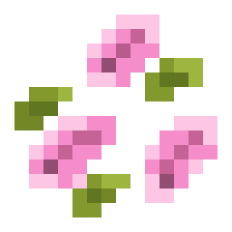<br><small>樱花瓣</small> | 破坏樱花树叶时 2% 概率额外掉落。 | 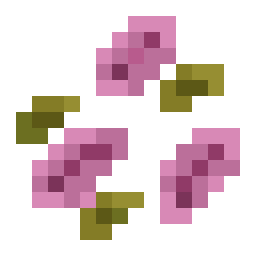<br><small>干樱花瓣</small> | 熔炉、烟熏炉或营火加工樱花瓣。 |
| 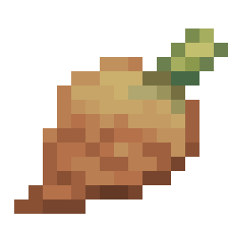<br><small>瓶子芋</small> | 砧板使用刀切割原版瓶子草，或拆开箱装瓶子芋。 | 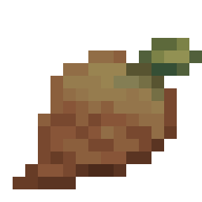<br><small>蒸瓶子芋</small> | 熔炉、烟熏炉或营火加工瓶子芋。 |
| 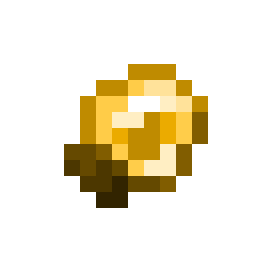<br><small>灯笼果</small> | 右键成熟灯笼果藤，或拆开箱装灯笼果。 | <br><small>金灯笼果</small> | 工作台有序合成：8 个金粒围住 1 个灯笼果；收获时也有 5% 概率额外掉落。 |
| 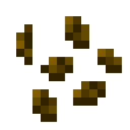<br><small>灯笼果种子</small> | 嗅探兽挖掘约 33% 概率额外掉落；破坏作物返还种子。 | 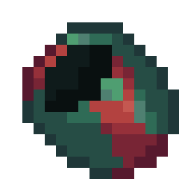<br><small>嗅探兽蛋壳</small> | 取完烤嗅探兽蛋或填馅嗅探兽蛋的最后一份后，盛宴方块变成蛋壳。 |

### 2、食物与饮品

| 物品 | 获取方式 | 物品 | 获取方式 |
|---|---|---|---|
| <br><small>煎嗅探兽蛋</small> | 烟熏炉或营火烹饪嗅探兽蛋；也可从烤嗅探兽蛋方块取餐。 | 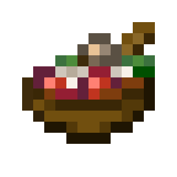<br><small>碗装填馅嗅探兽蛋</small> | 工作台无序合成：煎嗅探兽蛋 + 蒸瓶子芋 + 碗；也可从盛宴方块取餐。 |
| <br><small>烤火把花种子</small> | 熔炉、烟熏炉或营火加工火把花种子。 | <br><small>烤瓶子草荚果</small> | 熔炉、烟熏炉或营火加工瓶子草荚果。 |
| <br><small>古韵咖啡</small> | 烹饪锅：水桶 + 可可豆 + 火把花，玻璃瓶盛装。 | <br><small>火把花茶</small> | 烹饪锅：水桶 + 火把花 + 糖，玻璃瓶盛装。 |
| <br><small>樱花瓣茶</small> | 烹饪锅：水桶 + 樱花瓣 + 糖，玻璃瓶盛装。 | <br><small>瓶子草茶</small> | 烹饪锅：水桶 + 原版瓶子草 + 糖，玻璃瓶盛装。 |
| <br><small>奶酪切片</small> | 砧板切割奶酪轮，获得 4 个。 | 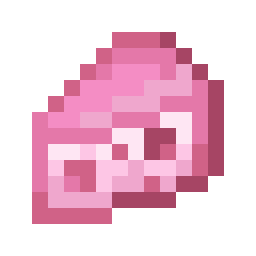<br><small>樱花奶酪切片</small> | 工作台无序合成：奶酪切片 + 樱花瓣。 |
| 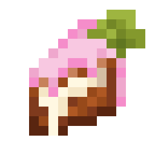<br><small>樱花蛋糕切片</small> | 砧板切割樱花蛋糕，获得 4 个。 | 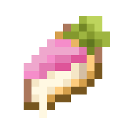<br><small>樱花奶酪派切片</small> | 砧板切割樱花奶酪派，获得 4 个。 |

### 3、方块、工具与容器

| 物品 | 获取方式 | 物品 | 获取方式 |
|---|---|---|---|
| <br><small>泥炉灶</small> | 工作台有序合成：8 个压实泥土围住 1 个营火；也可从沙漠水井的可疑沙子中考古获得（10% 概率），打火石点击即可工作。 | <br><small>陶锅</small> | 工作台有序合成：6 个红砖加 1 个炼药锅；也可从沙漠水井的可疑沙子中考古获得（10% 概率）。 |
| <br><small>箱装灯笼果</small> | 工作台有序合成：9 个灯笼果装箱；也可在工作台无序合成拆回 9 个。 | <br><small>箱装瓶子芋</small> | 工作台有序合成：9 个瓶子芋装箱；也可在工作台无序合成拆回 9 个。 |
| <br><small>陶土碗</small> | 工作台有序合成：3 个红砖按碗形摆放。 | <br><small>樱铁刀</small> | 锻造台：农夫乐事铁刀 + 樱花木板，无需锻造模板。 |
| <br><small>嗅探兽蛋壳刀</small> | 锻造台：农夫乐事铁刀 + 嗅探兽蛋或蛋壳，无需锻造模板。 | <br><small>凝乳块</small> | 烹饪锅：4 桶牛奶 + 2 份糖或蜂蜜，烹饪 600 tick。 |
| 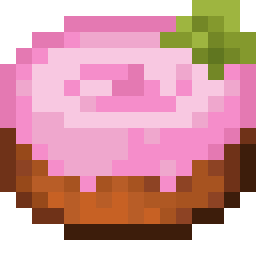<br><small>樱花蛋糕</small> | 工作台有序合成：樱花瓣、牛奶桶、糖、鸡蛋和小麦；也可在工作台用 4 片切片无序拼回。 | <br><small>樱花奶酪派</small> | 工作台有序合成：3 个樱花奶酪切片 + 1 个派皮；也可在工作台用 4 片切片无序拼回。 |
| <br><small>奶酪轮</small> | 工作台有序合成：4 个奶酪切片；凝乳块在亮度不高于 8 时熟成。 | <br><small>烤嗅探兽蛋方块</small> | 熔炉烘烤嗅探兽蛋。 |
| 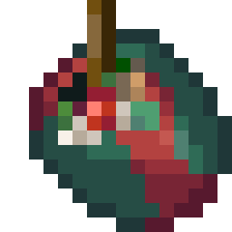<br><small>填馅嗅探兽蛋方块</small> | 工作台无序合成：4 个碗装填馅嗅探兽蛋；或使用烹饪锅制作。 | | |

## 与模组对比

已实现：

- 33 个物品、13 个方块及全部模型和纹理。
- 食物效果、药水效果、容器返还、切片与盛宴交互。
- 陶锅、泥炉灶、凝乳熟成、灯笼果作物和战利品扩展。
- 所有食品和饮品均有工作台、熔炉、烟熏炉、营火或 FarmersDelight 烹饪锅配方。

额外实现：

- 方块使用 CraftEngine 实体展示渲染。插件升级时自动更新 CraftEngine 内置资源。
- 中英文名称和 `/fd recipe` 独立配方页。
- 补充生存配方：泥炉灶、陶锅、两把刀、陶土碗及两种箱装作物。

存在差异：

- 凝乳使用随机刻熟成，不完全等同原模组固定计时。
- 烤嗅探兽蛋当前提供 4 份，原模组取 1 次后变成蛋壳。
- “瓶子草植株”既不能放置，也没有除砧板加工之外的其他用途。现在改为直接在农夫乐事砧板上用刀切割原版瓶子草，获得瓶子芋。

没有复刻的内容：

- 灯笼果藤未实现沿 FarmersDelight 绳索攀爬。
- 截至 2026-11-03，原模组 GitHub 仓库公开的源码仍对应 `1.3` 的旧版本；Modrinth 上已经发布到 `2.4`，本插件是根据 `1.3` 版本复刻，因此**不包含 `2.4` 新增的水晶树、水晶海棠果、竹篮、竹筒饭、冰淇淋等后续内容**。

## 可放置方块展示方式

全部自定义方块均使用 `item_display` 实体展示。

| 方块 | CraftEngine ID | 载体 | 碰撞与状态 |
|---|---|---|---|
| 泥炉灶 | `trailandtales_delight:mud_stove` | `barrier` | 完整方块碰撞；朝向和点火状态 |
| 陶锅 | `trailandtales_delight:pottery_cooking_pot` | `barrier` | 完整方块碰撞 |
| 箱装灯笼果 | `trailandtales_delight:lantern_fruit_crate` | `barrier` | 完整方块碰撞 |
| 箱装瓶子芋 | `trailandtales_delight:pitcher_taro_crate` | `barrier` | 完整方块碰撞 |
| 嗅探兽蛋壳 | `trailandtales_delight:sniffer_eggshell` | `barrier` | 完整方块碰撞 |
| 萌芽灯笼果 | `trailandtales_delight:budding_lantern_fruit` | `auto_state` | 按作物生长阶段切换状态 |
| 成熟灯笼果藤 | `trailandtales_delight:lantern_fruits` | `auto_state` | 按藤蔓生长阶段切换状态 |
| 凝乳块 | `trailandtales_delight:curd_block` | `structure_void` | 无碰撞；按熟成阶段切换模型 |
| 奶酪轮 | `trailandtales_delight:cheese_wheel` | `structure_void` | 无碰撞；按剩余片数切换模型 |
| 樱花蛋糕 | `trailandtales_delight:cherry_cake` | `structure_void` | 无碰撞；按剩余片数切换模型 |
| 樱花奶酪派 | `trailandtales_delight:cherry_cheese_pie` | `structure_void` | 无碰撞；按剩余片数切换模型 |
| 烤嗅探兽蛋 | `trailandtales_delight:cooked_sniffer_egg_block` | `barrier` | 完整方块碰撞；按剩余份数切换模型 |
| 填馅嗅探兽蛋 | `trailandtales_delight:stuffed_sniffer_egg_block` | `barrier` | 完整方块碰撞；按剩余份数切换模型 |

## 命令

```text
/fd recipe
/fd recipe trail_recipes
/fd recipe trailandtales_delight:trail_recipes
```

`cooking_pot`、`cutting_board` 和 `special` 是 FarmersDelight 的公共配方分类；`trail_recipes` 只展示陶锅私有工作站的配方。插件本身不增加独立命令。

## 语言

全局消息语言默认使用 `auto`。插件根据服务端 JVM/系统 Locale 自动选择英语、简体中文、日语、韩语、繁体中文、德语、法语、西班牙语或俄语；无法识别时回退到英语。

物品、方块、进度、配方页面和提示名称仍跟随玩家客户端语言。服务端全局消息可通过 `plugins/TrailTalesDelight/lang/<语言>.yml` 修改。

```yaml
# plugins/TrailTalesDelight/config.yml
language: auto
# 也可显式填写：
# en_us.yml、zh_cn.yml、ja_jp.yml、ko_kr.yml、zh_tw.yml、
# de_de.yml、fr_fr.yml、es_es.yml、ru_ru.yml
```

## 赞助与支持

如果本项目对你有帮助，可以通过 Ko-fi 或 爱发电 赞助开发。赞助后可提供插件安装、配置和故障排查等问答服务。

<p align="center">
  <a href='https://ko-fi.com/J5C529ZWWL' target='_blank'></a>
  <a href='https://afdian.com/a/sss000' target='_blank'></a>
</p>
