<p align="center">
  
</p>

<h1 align="center">TrailTalesDelight-CE</h1>

<p align="center">
  <a href="#installation-and-requirements"></a>
  <a href="https://github.com/Xiao-MoMi/craft-engine"></a>
  <a href="https://github.com/IOVEYOUMC0/Farmersdelight-Plugin"></a>
  <a href="#installation-and-requirements"></a>
  <a href="#installation-and-requirements"></a>
  <a href="#installation-and-requirements"></a>
</p>

<p align="center"><b>English</b> · <a href="README-zh.md">简体中文</a></p>

This is an unofficial port of [Trail-And-Tales-Delight](https://github.com/Vzling/Trail-And-Tales-Delight) for Paper servers using CraftEngine and the FarmersDelight plugin.

Paper, CraftEngine, and the Forge mod API behave differently, so this port cannot reproduce the original mod with 100% fidelity. The known differences are listed below.

The original mod is licensed under MIT. This port is licensed under AGPL-3.0.

## Installation and Requirements

- Server: Paper 1.21.5+ or the corresponding Folia version. Tested on `paper26.3` and `folia26.3`.
- Required: [CraftEngine](https://github.com/Xiao-MoMi/craft-engine) 26.9.1+
- Required: [FarmersDelight-Plugin](https://github.com/IOVEYOUMC0/Farmersdelight-Plugin)
- Optional: [UltimateAdvancementAPI](https://github.com/IOVEYOUMC0/UltimateAdvancementAPI)
- Place the plugin in `plugins/` and fully restart the server.
- CraftEngine resources are installed automatically under `plugins/CraftEngine/resources/trailandtales_delight/`.
- Add `minecraft:pitcher_plant: { style: item }` under `items` in `plugins/FarmersDelight/display-overrides.yml` so the cutting board displays pitcher plants as flat items.

## Item Overview

### 1. Crops, Drops, and Basic Materials

| Item | Acquisition | Item | Acquisition |
|---|---|---|---|
| 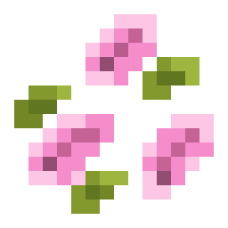<br><small>Cherry Petal</small> | 2% extra drop chance when breaking cherry leaves. | 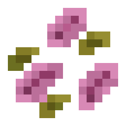<br><small>Dried Cherry Petal</small> | Process cherry petals in a furnace, smoker, or campfire. |
| 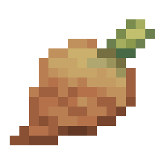<br><small>Pitcher Taro</small> | Cut vanilla pitcher plants with a knife or unpack a pitcher taro crate. | 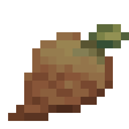<br><small>Cooked Pitcher Taro</small> | Cook pitcher taro in a furnace, smoker, or campfire. |
| 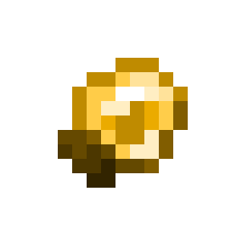<br><small>Lantern Fruit</small> | Right-click a mature lantern fruit vine or unpack a lantern fruit crate. | <br><small>Golden Lantern Fruit</small> | Craft with one lantern fruit surrounded by eight gold nuggets; harvesting also has a 5% extra drop chance. |
| 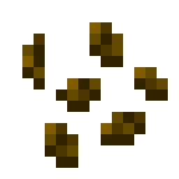<br><small>Lantern Fruit Seeds</small> | About a 33% extra drop chance from sniffer digging; breaking the crop returns seeds. | 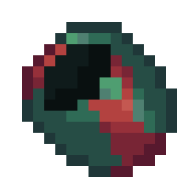<br><small>Sniffer Eggshell</small> | Taking the final serving from a cooked or stuffed sniffer egg replaces the feast with an eggshell. |

### 2. Food and Drinks

| Item | Acquisition | Item | Acquisition |
|---|---|---|---|
| <br><small>Fried Sniffer Egg</small> | Cook a sniffer egg in a smoker or campfire, or take a serving from a cooked sniffer egg feast. | 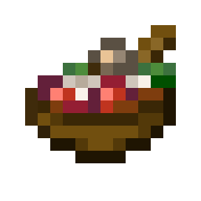<br><small>Stuffed Sniffer Egg</small> | Craft fried sniffer egg, cooked pitcher taro, and a bowl, or take a serving from a stuffed sniffer egg feast. |
| <br><small>Baked Torchflower Seeds</small> | Cook torchflower seeds in a furnace, smoker, or campfire. | <br><small>Baked Pitcher Pod</small> | Cook pitcher pods in a furnace, smoker, or campfire. |
| <br><small>Ancient Coffee</small> | Cooking pot: water bucket, cocoa beans, and torchflower, served in a glass bottle. | <br><small>Torchflower Tea</small> | Cooking pot: water bucket, torchflower, and sugar, served in a glass bottle. |
| <br><small>Cherry Petal Tea</small> | Cooking pot: water bucket, cherry petal, and sugar, served in a glass bottle. | <br><small>Pitcher Plant Tea</small> | Cooking pot: water bucket, vanilla pitcher plant, and sugar, served in a glass bottle. |
| <br><small>Cheese Slice</small> | Cut a cheese wheel on a cutting board for four slices. | <br><small>Cherry Cheese Slice</small> | Craft a cheese slice with a cherry petal. |
| 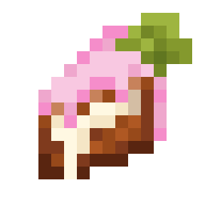<br><small>Cherry Cake Slice</small> | Cut a cherry cake on a cutting board for four slices. | 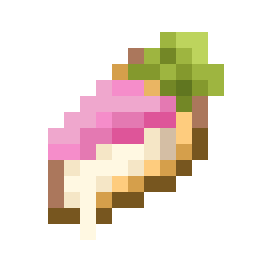<br><small>Cherry Cheese Pie Slice</small> | Cut a cherry cheese pie on a cutting board for four slices. |

### 3. Blocks, Tools, and Containers

| Item | Acquisition | Item | Acquisition |
|---|---|---|---|
| 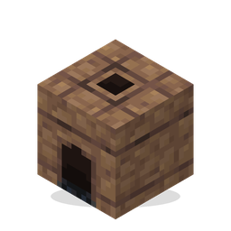<br><small>Mud Stove</small> | Craft with eight packed mud around a campfire; also a 10% archaeology chance from desert well suspicious sand. Light it with flint and steel. | <br><small>Pottery Cooking Pot</small> | Craft with six bricks and a cauldron; also a 10% archaeology chance from desert well suspicious sand. |
| <br><small>Lantern Fruit Crate</small> | Craft from nine lantern fruits; unpack back into nine lantern fruits. | 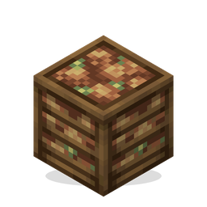<br><small>Pitcher Taro Crate</small> | Craft from nine pitcher taros; unpack back into nine pitcher taros. |
| 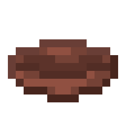<br><small>Pottery Bowl</small> | Craft three bricks in a bowl pattern. | <br><small>Cherry Iron Knife</small> | Smith a FarmersDelight iron knife with cherry planks; no smithing template is required. |
| 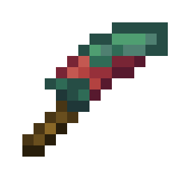<br><small>Sniffer Eggshell Knife</small> | Smith a FarmersDelight iron knife with a sniffer egg or eggshell; no smithing template is required. | <br><small>Curd Block</small> | Cooking pot: four milk buckets and two sugar or honey; cooking time is 600 ticks. |
| <br><small>Cherry Cake</small> | Craft from cherry petals, milk, sugar, egg, and wheat; four slices can also be combined back into a cake. | 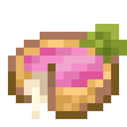<br><small>Cherry Cheese Pie</small> | Craft from three cherry cheese slices and a pie crust; four slices can also be combined back into a pie. |
| <br><small>Cheese Wheel</small> | Craft from four cheese slices, or ripen a curd block at light level 8 or below. | <br><small>Cooked Sniffer Egg Block</small> | Cook a sniffer egg in a furnace. |
| 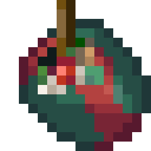<br><small>Stuffed Sniffer Egg Block</small> | Craft from four stuffed sniffer eggs, or make it in a cooking pot. | | |

## Mod Comparison

Implemented:

- 33 items, 13 blocks, and all associated models and textures.
- Food effects, potion effects, container returns, slicing, and feast interactions.
- The pottery cooking pot, mud stove, curd aging, lantern fruit crops, and loot integrations.
- Crafting table, furnace, smoker, campfire, or FarmersDelight cooking-pot recipes for every food and drink.

Additional port features:

- Custom blocks render through CraftEngine item-display entities. CraftEngine resources update automatically when the plugin version changes.
- Chinese and English names, plus a dedicated `/fd recipe` category.
- Added survival recipes for the mud stove, pottery cooking pot, both knives, the pottery bowl, and both crop crates.

Known differences:

- Curd ripening uses random ticks rather than the original mod's fixed timer.
- The cooked sniffer egg currently provides four servings; the original changes to an eggshell after one serving.
- The original custom pitcher plant item cannot be placed and has no use beyond cutting-board processing. The port instead lets players cut vanilla pitcher plants on a FarmersDelight cutting board to obtain pitcher taro.

Not ported:

- Lantern fruit vines cannot climb FarmersDelight ropes.
- As of 2026-11-03, the public GitHub source still corresponds to the older `1.3` release, while Modrinth has published `2.4`. This plugin is based on `1.3` and does **not** include the `2.4` crystal tree, crystal crabapple, bamboo basket, bamboo tube rice, ice cream, or other later content.

## Block Presentation

All custom blocks use `item_display` entities for visual rendering.

| Block | CraftEngine ID | Carrier | Collision and State |
|---|---|---|---|
| Mud Stove | `trailandtales_delight:mud_stove` | `barrier` | Full-block collision; facing and lit state |
| Pottery Cooking Pot | `trailandtales_delight:pottery_cooking_pot` | `barrier` | Full-block collision |
| Lantern Fruit Crate | `trailandtales_delight:lantern_fruit_crate` | `barrier` | Full-block collision |
| Pitcher Taro Crate | `trailandtales_delight:pitcher_taro_crate` | `barrier` | Full-block collision |
| Sniffer Eggshell | `trailandtales_delight:sniffer_eggshell` | `barrier` | Full-block collision |
| Budding Lantern Fruit | `trailandtales_delight:budding_lantern_fruit` | `auto_state` | State changes with crop growth |
| Mature Lantern Fruit Vine | `trailandtales_delight:lantern_fruits` | `auto_state` | State changes with vine growth |
| Curd Block | `trailandtales_delight:curd_block` | `structure_void` | No collision; model changes with ripening stage |
| Cheese Wheel | `trailandtales_delight:cheese_wheel` | `structure_void` | No collision; model changes with remaining slices |
| Cherry Cake | `trailandtales_delight:cherry_cake` | `structure_void` | No collision; model changes with remaining slices |
| Cherry Cheese Pie | `trailandtales_delight:cherry_cheese_pie` | `structure_void` | No collision; model changes with remaining slices |
| Cooked Sniffer Egg | `trailandtales_delight:cooked_sniffer_egg_block` | `barrier` | Full-block collision; model changes with remaining servings |
| Stuffed Sniffer Egg | `trailandtales_delight:stuffed_sniffer_egg_block` | `barrier` | Full-block collision; model changes with remaining servings |

## Commands

```text
/fd recipe
/fd recipe trail_recipes
/fd recipe trailandtales_delight:trail_recipes
```

`cooking_pot`, `cutting_board`, and `special` are public FarmersDelight recipe categories. `trail_recipes` shows recipes executed by the addon's pottery cooking-pot station. This plugin does not register a separate command.

## Language

Simplified Chinese is the default server language, and English is bundled. Item, block, advancement, and tooltip names shown to players follow the client language. Resource-pack translations are located under `plugins/CraftEngine/resources/trailandtales_delight/resourcepack/assets/trailandtales_delight/lang/`.

```yaml
# plugins/TrailTalesDelight/config.yml
language: zh_cn # zh_cn or en_us
```

## Sponsorship and Support

If this project helps you, you can support development through Ko-fi or Afdian. Sponsors can request plugin installation, configuration, and troubleshooting.

<p align="center">
  <a href='https://ko-fi.com/J5C529ZWWL' target='_blank'></a>
  <a href='https://afdian.com/a/sss000' target='_blank'></a>
</p>
